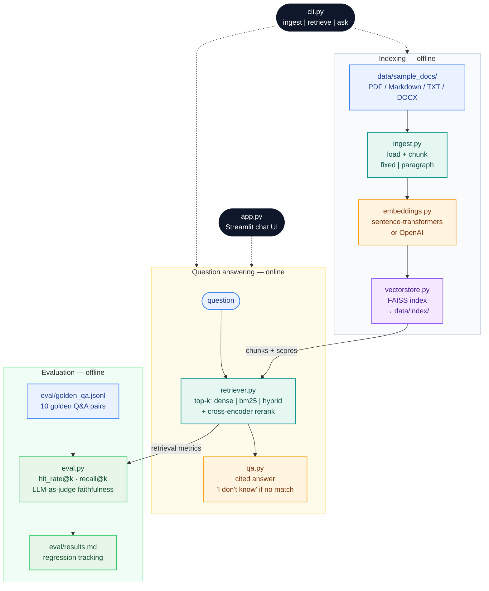

# RAG Knowledge-Base Q&A

[](https://github.com/rufengma/RAG-knowledge-qa/actions/workflows/ci.yml)

A clean, minimal Retrieval-Augmented Generation pipeline: ingest your documents
(PDF/Markdown/TXT/DOCX), index them with FAISS, and ask questions with cited answers.
Built as a portfolio project — readable code, real evals, no magic.

## Architecture



Index once, then ask from the CLI (`python cli.py ask "…"`), the Streamlit UI
(`streamlit run app.py`), or run the offline evals (`python -m src.eval`).

## Quickstart

```bash
python -m venv .venv && source .venv/bin/activate
pip install -r requirements.txt

# 1. Build the index from the sample docs (no API key needed)
python cli.py ingest data/sample_docs

# 2. Inspect retrieval (no API key needed)
python cli.py retrieve "What is RAG?"

# 3. Ask a question (needs OPENAI_API_KEY in .env)
cp .env.example .env   # then add your key
python cli.py ask "What is RAG?"

# 4. Run the eval suite (retrieval metrics need no API key)
python -m src.eval

# 5. Launch the web UI
streamlit run app.py
```

## CLI reference

All flags, as shown by `python cli.py <command> --help`:

| Command | Flags | Notes |
|---|---|---|
| `ingest <docs_dir>` | — | Builds the FAISS index from `.pdf`/`.md`/`.txt`/`.markdown`/`.docx` files in the folder. Chunking and embedding come from `.env` (`CHUNK_STRATEGY`, `CHUNK_SIZE`, `EMBEDDING_PROVIDER`…). |
| `ask "<question>"` | `--rerank` | Generates a cited answer (needs `OPENAI_API_KEY`). Without `--rerank` it uses the `RERANK` env setting. |
| `retrieve "<question>"` | `--top-k N`, `--strategy {dense,bm25,hybrid}`, `--rerank` | Retrieval only, no LLM needed. `--top-k` overrides `TOP_K` (default 5); `--strategy` overrides `RETRIEVAL_STRATEGY` (default `dense`); `--rerank` forces cross-encoder reranking on. |
| `python -m src.eval` | `--golden PATH`, `--judge`, `--top-k K [K …]`, `--strategy {dense,bm25,hybrid}`, `--rerank` | Evaluates on the golden set (default `eval/golden_qa.jsonl`). `--judge` adds the LLM-as-judge faithfulness check (needs API key); `--top-k` sweeps several depths in one run. |

```bash
python cli.py ingest data/sample_docs
python cli.py retrieve "What is RAG?" --top-k 3 --strategy hybrid --rerank
python cli.py ask "What is RAG?" --rerank
python -m src.eval --strategy hybrid --rerank --top-k 1 3 5 10
```

## Configuration

All settings live in `src/config.py` and are overridable via environment
variables or a `.env` file (see `.env.example`):

| Variable | Default | Description |
|---|---|---|
| `OPENAI_API_KEY` | — | Required for `ask`, the UI, and `--judge`. Not needed for ingest/retrieval/eval. |
| `LLM_BASE_URL` | `https://api.openai.com/v1` | Any OpenAI-compatible endpoint (Ollama, vLLM, Together…) |
| `LLM_MODEL` | `gpt-4o-mini` | Chat model for answer generation |
| `EMBEDDING_PROVIDER` | `local` | `local` (sentence-transformers) or `openai` |
| `EMBEDDING_MODEL` | `all-MiniLM-L6-v2` | Local embedding model |
| `OPENAI_EMBEDDING_MODEL` | `text-embedding-3-small` | Used when `EMBEDDING_PROVIDER=openai` |
| `CHUNK_SIZE` | `500` | Characters per chunk |
| `CHUNK_OVERLAP` | `50` | Overlap between consecutive chunks |
| `CHUNK_STRATEGY` | `fixed` | `fixed` or `paragraph` |
| `TOP_K` | `5` | Retrieved chunks per query |
| `RETRIEVAL_STRATEGY` | `dense` | `dense` (FAISS cosine), `bm25` (keyword), or `hybrid` (weighted-sum fusion) |
| `HYBRID_ALPHA` | `0.4` | Dense weight in hybrid fusion (`0` = pure BM25, `1` = pure dense) |
| `RERANK` | `false` | `true` to rerank first-stage candidates with a cross-encoder |
| `RERANK_MODEL` | `cross-encoder/ms-marco-MiniLM-L6-v2` | Cross-encoder model for reranking |
| `RERANK_CANDIDATES` | `20` | First-stage candidate pool size to rerank |
| `USAGE_LOG` | *(empty)* | JSONL path for per-query usage logging (tokens + latency); empty = disabled |

Changing the embedding model invalidates the index — the loader checks the
stored model name and tells you to re-run ingest.

### Query usage log

Set `USAGE_LOG=data/usage.jsonl` to append one JSON line per answered question:

```json
{"timestamp": "2026-10-09T14:12:03+00:00", "question": "What is RAG?",
 "model": "gpt-4o-mini", "grounded": true, "num_sources": 3,
 "prompt_tokens": 812, "completion_tokens": 64, "total_tokens": 876,
 "latency_ms": 1234.5}
```

Refusals ("I don't know") are logged too, with `null` token counts and
`grounded: false` — useful for spotting hard questions. Token counts are `null`
when the provider's response omits `usage`. Disabled by default.

## Evaluation

`eval/golden_qa.jsonl` holds 10 golden Q&A pairs over the sample docs, each
labeled with the source file(s) a good retriever should surface.

```bash
python -m src.eval                    # retrieval metrics only
python -m src.eval --judge             # + LLM-as-judge faithfulness (needs API key)
python -m src.eval --top-k 1 3 5 10   # sweep retrieval depth
```

Retrieval metrics (no LLM needed):

- **hit_rate@k** — fraction of questions with ≥1 expected doc in top-k
- **recall@k** — fraction of expected docs found in top-k

To compare chunking strategies: change `CHUNK_STRATEGY`/`CHUNK_SIZE` in `.env`,
re-run `python cli.py ingest data/sample_docs`, then `python -m src.eval`.
Record the table in `eval/results.md` to track regressions.

Every push and pull request runs the unit tests and the golden-set eval on
GitHub Actions (`.github/workflows/ci.yml`): install deps, `pytest tests/`,
build the index from `data/sample_docs`, then `python -m src.eval` with both
the `dense` and `hybrid` strategies — no API key needed.

## Hybrid retrieval

Dense embeddings sometimes miss keyword-heavy queries (acronyms, error codes,
product names). `RETRIEVAL_STRATEGY=hybrid` fuses dense cosine scores with an
in-house BM25 implementation (`src/hybrid.py`, no extra dependency): both
candidate lists are min-max normalized and combined as
`alpha * dense + (1 - alpha) * bm25` with `alpha = HYBRID_ALPHA`.

```bash
python cli.py retrieve "What are HNSW and IVF used for?" --strategy hybrid
python -m src.eval --strategy hybrid        # eval with hybrid retrieval
python -m src.eval --strategy bm25          # BM25 only, no embeddings needed
```

`HYBRID_ALPHA=0.4` is the default because a sweep on the golden set showed it
fixes the acronym miss (hit_rate@3: 90% → 100%) without regressing anything
dense already got right; `0.5` reintroduced a miss on this small corpus.
Re-tune it on your own golden set for real corpora. Pure BM25 (`bm25`) is
useful when you want keyword search without loading an embedding model.

## Cross-encoder reranking

Bi-encoder scores (dense cosine, BM25) are cheap but coarse. `--rerank` adds
a second stage: fetch a larger candidate pool (`RERANK_CANDIDATES`, default 20)
with the first-stage strategy, then score each (query, chunk) pair jointly
with a cross-encoder (`src/rerank.py`, default
`cross-encoder/ms-marco-MiniLM-L6-v2`, downloaded once and cached). The pool
is reordered down to the final top-k. The original first-stage `score` is kept
on each chunk (so the relevance threshold in `qa.py` still works on cosine
scores); the cross-encoder logit is exposed as `rerank_score`.

```bash
python cli.py retrieve "What are HNSW and IVF used for?" --strategy hybrid --rerank
python -m src.eval --strategy hybrid --rerank   # measure the gain on the golden set
```

Reranking costs one model load (~80 MB, CPU-friendly) and ~20 ms per
(query, chunk) pair, so keep it behind the flag (or `RERANK=true`) and off the
hot path when latency matters. On the sample golden set, hybrid + rerank
keeps hit_rate@3 at 100% with more stable top-1 ordering (see
`eval/results.md`).

## Troubleshooting

| Symptom | Cause | Fix |
|---|---|---|
| `ValueError: Index was built with embedding model '...'` | You changed `EMBEDDING_MODEL` or `EMBEDDING_PROVIDER` after ingesting; the stored index no longer matches | Re-run `python cli.py ingest data/sample_docs` |
| `ValueError: OPENAI_API_KEY is not set — copy .env.example to .env and add your key.` | `ask` / the Streamlit UI needs an LLM, but no key is set | `cp .env.example .env` and add your key (retrieval-only commands don't need one) |
| `ValueError: OPENAI_API_KEY is required for --judge` | `python -m src.eval --judge` calls an LLM as judge | Set `OPENAI_API_KEY`, or drop `--judge` for retrieval metrics only |
| `ValueError: Env var TOP_K must be an int, got '...'` | A numeric setting in `.env` isn't a number | Fix the value (e.g. `TOP_K=5`) — the config parser validates ints/floats on load |
| Retrieval returns stale answers after editing docs | The index is only rebuilt on `ingest` | Re-run `python cli.py ingest data/sample_docs` after changing any document |
| First run is slow | Embedding and rerank models download on first use (~80–90 MB each) | Wait for the initial download; subsequent runs use the local cache |
| Pointing at a local LLM (Ollama/vLLM) fails | `LLM_BASE_URL`/`LLM_MODEL` not overridden | Set `LLM_BASE_URL=http://localhost:11434/v1` and `LLM_MODEL=<your model>` in `.env` |

## Project layout

```
├── app.py              # Streamlit UI: upload docs, chat with citations
├── cli.py              # CLI: ingest | ask | retrieve
├── requirements.txt
├── .env.example
├── src/
│   ├── config.py       # env-based settings
│   ├── ingest.py       # load pdf/md/txt/docx + chunking (fixed, paragraph)
│   ├── embeddings.py   # local (sentence-transformers) / OpenAI embeddings
│   ├── vectorstore.py   # FAISS wrapper + disk persistence
│   ├── retriever.py    # top-k retrieval: dense / bm25 / hybrid fusion (+ rerank)
│   ├── hybrid.py       # in-house BM25 index (no extra dependency)
│   ├── rerank.py       # cross-encoder second-stage reranking
│   ├── qa.py           # RAG chain: cited answers + "I don't know" fallback
│   ├── usage.py        # per-query token/latency JSONL logging (USAGE_LOG)
│   └── eval.py         # golden-set eval: retrieval metrics + LLM judge
├── tests/              # pytest suites: ingest / eval / usage / config
├── data/
│   ├── sample_docs/    # 4 short markdown docs so the demo works out of the box
│   └── index/          # built FAISS index (gitignored)
└── eval/
    ├── golden_qa.jsonl # 10 golden Q&A pairs
    └── results.md      # (you) paste eval tables here over time
```

## Roadmap

- [x] Hybrid retrieval: BM25 + dense with weighted-sum fusion (alpha tunable via `HYBRID_ALPHA`)
- [ ] Reranker stage (cross-encoder) before generation
- [ ] Semantic chunking strategy
- [ ] Multi-query / HyDE query expansion
- [ ] Dockerfile + one-command demo
- [ ] Persisted eval history with charts in `eval/results.md`

## License

MIT — see [LICENSE](LICENSE).
